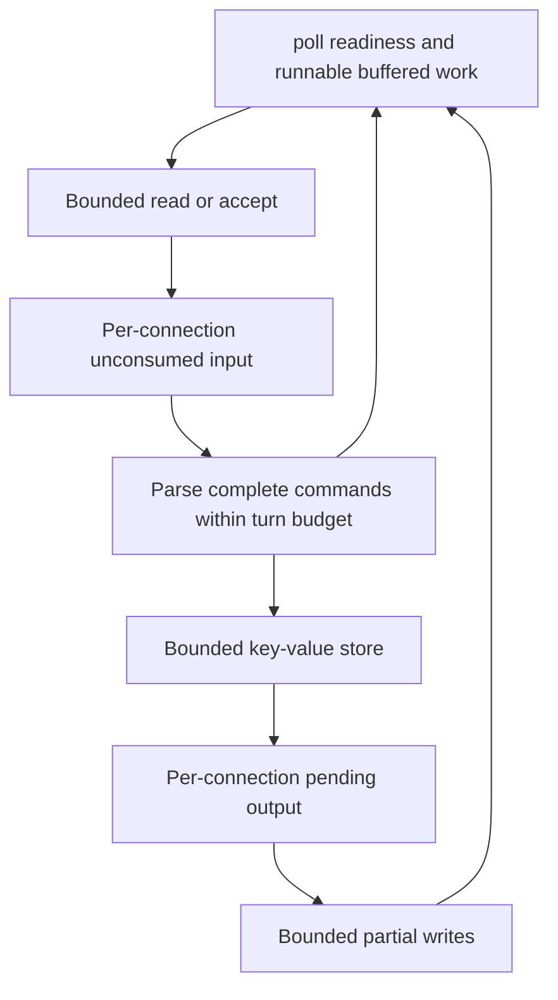
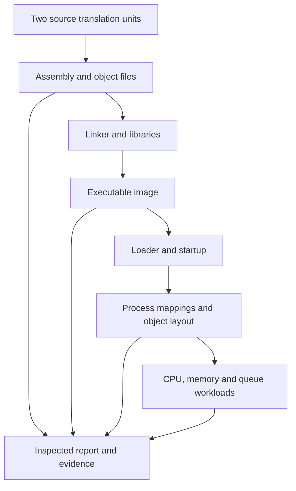

# Architecture boundaries

These diagrams describe the agreed design, not an inspected implementation. Replace proposed component names with actual code references as implementation proceeds.

## Server ownership and byte flow

One event-loop thread owns all connections and the store. A readable event does not mean one complete request, and one write call does not mean a full reply.

The real implementation must schedule complete buffered commands even when no new socket event arrives. Output offset/state survives partial writes. Writable interest is active only with pending bytes. EOF and draining have explicit states and a monotonic deadline; a slow connection cannot own the loop indefinitely.

## Inspector: artifacts versus running process

Report what was observed, on which platform and with which commands. Virtual addresses do not identify physical frames. The toy page translator is a model. Disassembly and ABI/layout observations are implementation/platform evidence; they do not redefine C++ language guarantees.

## Private runner boundaries

Keep four areas separate: live learner checkout; author/reference assessment material; isolated allowlisted attempt history; tool-owned execution workspace. Assessment implementation stays outside learner snapshots, but its immutable version/hash must accompany the result so both tested source and assessment are reproducible.

A source checkpoint is created before execution. A final result is persisted atomically before its result commit. Later live edits belong to another attempt. The dashboard and context consume recorded facts; they do not execute native commands or independently infer learner understanding.
